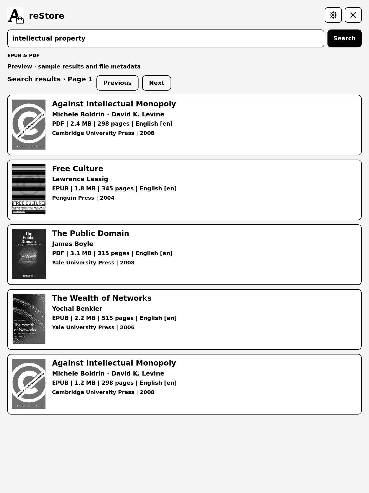

# reStore

Native book search and downloads for **reMarkable 2**, built with AppLoad and XOVI.
Search Anna's Archive, choose an EPUB or PDF, and import it into a folder in your
reMarkable library. Search results and book details use a native, high-contrast
layout with grayscale covers. Everything runs on the tablet.



## What it does

- Searches EPUB and PDF editions by title, author or ISBN. Keyboard **Done** starts
  the search.
- Shows covers, titles, authors, format, size and available publisher, language,
  year and page metadata. Missing page counts are marked unavailable.
- Lists the book's slow download servers in a dropdown above **Download**.
- Displays the site's countdown, transfer progress and received bytes. Files named
  simply `download` are recognized by their PDF/EPUB contents.
- Opens interactive verification on the tablet. Tap a CAPTCHA text field to open
  the keyboard; **Done** submits text. reStore continues automatically after it
  recognizes the accepted page. **Continue** is available as a fallback.
- Supports swipe scrolling and hold-then-drag CAPTCHA puzzles. Opening the keyboard
  preserves the bottom half of the browser image above it.
- Saves cookies between sessions and imports books using their titles into the
  folder selected under **Settings → Download books to**.
- Reuses a finished cached download when its MD5 matches the selected book.

The home screen displays: “Please consider donating to Anna's Archive to support
the largest truly open library in human history.” This is plain text, not a link.
reStore is independent of Anna's Archive.

## Requirements

| Item | Supported configuration |
|---|---|
| Tablet | reMarkable 2, ARMv7 |
| Device software | Developed and tested on 3.27.3.0, Qt 6.8.2 |
| Launcher | XOVI with AppLoad 0.5.3 or later |
| Connection | Tablet internet access; no companion computer/server during use |
| Storage | About 400 MiB for the bundled runtime, plus cookies, downloads and imported books |

Other devices and firmware versions have not been validated. AppLoad and XOVI
are prerequisites and are not included in this package.

## Install

Download `reStore-0.1.0-armv7.tar.gz` from the
[v0.1.0 release](https://github.com/Ampleforth/reStore/releases/tag/v0.1.0)
once published. Verify it against the release's `SHA256SUMS`.

The archive contains `archive-books/`. Install that directory under
`/home/root/xovi/exthome/appload/`, then refresh AppLoad and open **reStore**.
The internal directory and application ID remain stable for existing users.

For an upgrade, close reStore first and replace the application files while
preserving `archive-books/runtime/state/` and the configuration directory.
A tablet reboot is not required. Do not overwrite a live browser profile.
See [installation and usage](docs/USER_GUIDE.md) for the full steps.

A [Vellum recipe](packaging/vellum/VELBUILD) is provided for submission to the
Vellum package repository. This does not mean reStore is already in its index.

## Screenshots

These are regenerated previews of the real QML interface with illustrative
metadata and covers, not photographs of live searches or CAPTCHAs.

| Screen | Preview |
|---|---|
| Home | [Large donation message and search box](docs/home.png) |
| Results | [Multiple books and grayscale covers](docs/results.png) |
| Book | [Metadata and download button](docs/book.png) |
| Server selection | [Download link dropdown](docs/links.png) |
| Waiting | [Server countdown](docs/countdown.png) |
| Transfer | [Download progress](docs/progress.png) |
| Destination | [My files folder browser](docs/folders.png) |
| Search input | [Calendar-style keyboard](docs/keyboard.png) |
| Verification | [Browser and instructions](docs/browser.png) |
| Verification input | [Bottom of browser visible above keyboard](docs/browser-keyboard.png) |

[Preview cover attribution](docs/covers/SOURCES.md) · [App icon](docs/icon.png)

## Documentation

- [Usage, settings and upgrades](docs/USER_GUIDE.md)
- [Troubleshooting](docs/TROUBLESHOOTING.md)
- [Architecture and private data](docs/ARCHITECTURE.md)
- [Building, testing and preview generation](docs/BUILDING.md)
- [Release assets and Vellum packaging](docs/RELEASING.md)
- [Changelog](CHANGELOG.md)

## Development

```sh
./scripts/build.sh
./scripts/preview.sh
./scripts/release.sh
```

Build dependencies, exact outputs and optional tool paths are documented in
[BUILDING.md](docs/BUILDING.md). Runtime package versions and SHA-256 hashes are
pinned in `packaging/runtime.lock.json`.

## License and credits

reStore application code is **GPL-3.0-only**. The keyboard and controls follow the
[Nextcloud Calendar app](https://github.com/Ampleforth/remarkable2-nextcloudCalendar).
The adapted MIT toolbar notice, font licenses, Go license and Debian runtime
notices are retained. See [third-party notices](THIRD_PARTY_NOTICES.md) and
[LICENSE](LICENSE). Firmware APIs and site markup can change; parser failures
are reported rather than replaced with invented book data.
